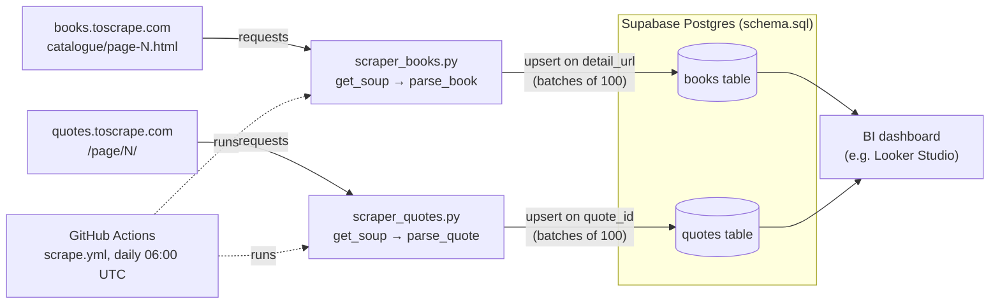

# bis2-scraper

**A small scrape-to-dashboard data pipeline.** Two Python scrapers collect structured data from public practice sites and upsert it into Supabase (Postgres), ready for a BI dashboard such as Looker Studio.

[](https://github.com/LuisEduardoGE/bis2-scraper/actions/workflows/ci.yml)
[](LICENSE)


| Scraper | Source | Table | Rows |
|---|---|---|---|
| `scraper_books.py` | [books.toscrape.com](https://books.toscrape.com) | `books`: title, price, rating, stock, url | 1,000 |
| `scraper_quotes.py` | [quotes.toscrape.com](https://quotes.toscrape.com) | `quotes`: text, author, tags[] | 100 |

Both sites are sandboxes built for scraping practice. Sample output is committed as `books.csv` and `quotes.csv`.

## Table of Contents

- [Features](#features)
- [Tech Stack](#tech-stack)
- [Architecture](#architecture)
- [Quick Start](#quick-start)
- [Configuration](#configuration)
- [Usage](#usage)
- [Scheduled runs](#scheduled-runs)
- [Testing](#testing)
- [Project Structure](#project-structure)
- [Author](#author)
- [License](#license)

## Features

- **Two scrapers, one pattern:** fetch a page, parse it with BeautifulSoup, follow the `next` link until the last page.
- **Polite:** 30-second request timeouts, an explicit User-Agent and a 0.5 s pause between pages.
- **Idempotent:** upserts on a natural key (`detail_url` for books, a hash of author + text for quotes), so re-running never duplicates rows.
- **Batched writes:** rows are upserted 100 at a time.
- **Dashboard-ready schema:** tags are stored as a Postgres `text[]` array; indexes on rating, price and author support dashboard queries.
- **Scheduled:** a GitHub Actions cron keeps the tables fresh daily.

## Tech Stack

| Layer | Choice |
|---|---|
| Language | Python 3.9+ (CI runs 3.12) |
| HTTP | requests |
| Parsing | BeautifulSoup 4 (`html.parser`) |
| Storage | Supabase (Postgres) via `supabase-py` |
| Config | environment variables, optional `.env` via python-dotenv |
| Scheduling | GitHub Actions cron (`scrape.yml`) |
| Tests / lint | pytest, ruff |

## Architecture



Each scraper is a single script. `scrape_all()` walks the paginated listing, calling `get_soup()`
for each page and a pure `parse_*()` function for each item, then `main()` upserts the rows in
batches of 100 using the table's unique key. The schema lives in [`schema.sql`](schema.sql).

## Quick Start

Prerequisites: Python 3.9+ and a Supabase project.

1. Run [`schema.sql`](schema.sql) in the Supabase SQL editor.
2. Install:

```bash
python -m venv .venv
source .venv/bin/activate        # Windows: .venv\Scripts\activate
make install                     # or: pip install -r requirements-dev.txt
```

`requirements.txt` holds the runtime dependencies only; `requirements-dev.txt` adds pytest and ruff.

3. Copy `.env.example` to `.env` (git-ignored) and fill in the two values below.
4. Run the scrapers:

```bash
python scraper_books.py
python scraper_quotes.py
```

## Configuration

Both scrapers read these from the environment, or from a `.env` file if present (see [`.env.example`](.env.example)).

| Variable | Default | Purpose |
|---|---|---|
| `SUPABASE_URL` | none (required) | Project URL, `https://<project-ref>.supabase.co` (Supabase → Project Settings → API) |
| `SUPABASE_KEY` | none (required) | `service_role` key, so inserts work past Row-Level Security. Keep it secret; never commit `.env` |

## Usage

```bash
python scraper_books.py      # Scraped 1000 books / Upserted to Supabase table 'books'
python scraper_quotes.py     # Scraped 100 quotes / Upserted to Supabase table 'quotes'
```

Example dashboard question this feeds: "Which authors and themes (tags) dominate the collection?"

## Scheduled runs

[`.github/workflows/scrape.yml`](.github/workflows/scrape.yml) runs both scrapers every day at 06:00 UTC on GitHub Actions, and on demand via *Run workflow*. Add `SUPABASE_URL` and `SUPABASE_KEY` as repository secrets (Settings → Secrets and variables → Actions).

## Testing

```bash
make test      # pytest -q
make lint      # ruff check .
```

13 tests pass, fully offline: the network and `time.sleep` are blocked, and Supabase is replaced
by a fake client. They cover:

- **Parsing** against trimmed copies of real pages saved in `tests/fixtures/`: every book field (full title from the `title` attribute, £ price, star-rating word → number, stock, absolute detail URL), quote text, author and tags, and the stable `quote_id` hash.
- **Agreement with the committed sample CSVs** (`books.csv`, `quotes.csv`).
- **Pagination:** `scrape_all()` follows the `next` link and stops on the last page.
- **Upserts:** `main()` writes batches of 100 to the right table with the right conflict key.

CI ([`ci.yml`](.github/workflows/ci.yml)) runs `make install`, `make lint` and `make test` on every push and pull request to `main`.

## Project Structure

```
scraper_books.py       books.toscrape.com -> Supabase `books`
scraper_quotes.py      quotes.toscrape.com -> Supabase `quotes`
schema.sql             tables, unique upsert keys and indexes
books.csv, quotes.csv  sample output
tests/                 offline pytest suite + saved HTML fixtures
.github/workflows/     scrape.yml (daily scrape), ci.yml (lint + tests)
requirements.txt       runtime deps; requirements-dev.txt adds pytest and ruff
.env.example           placeholder Supabase settings
Makefile               install / test / lint / clean
```

## Author

**Luis Eduardo G. Espindola** · [GitHub](https://github.com/LuisEduardoGE) · [LinkedIn](https://www.linkedin.com/in/luisgespindola/)

## License

[MIT](LICENSE) © Luis Eduardo G. Espindola
